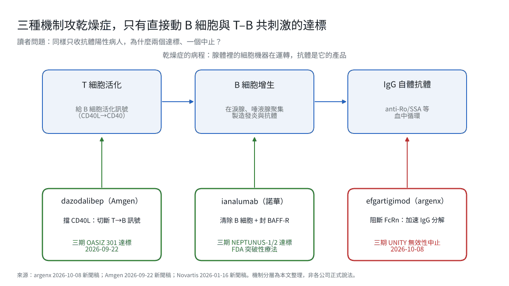
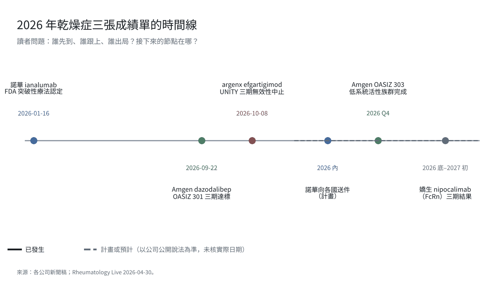
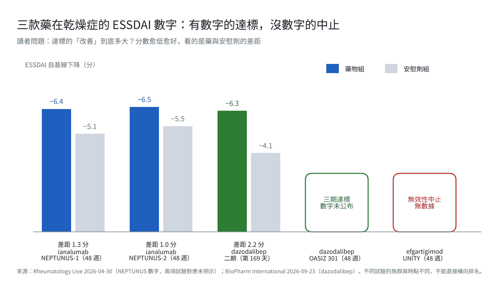
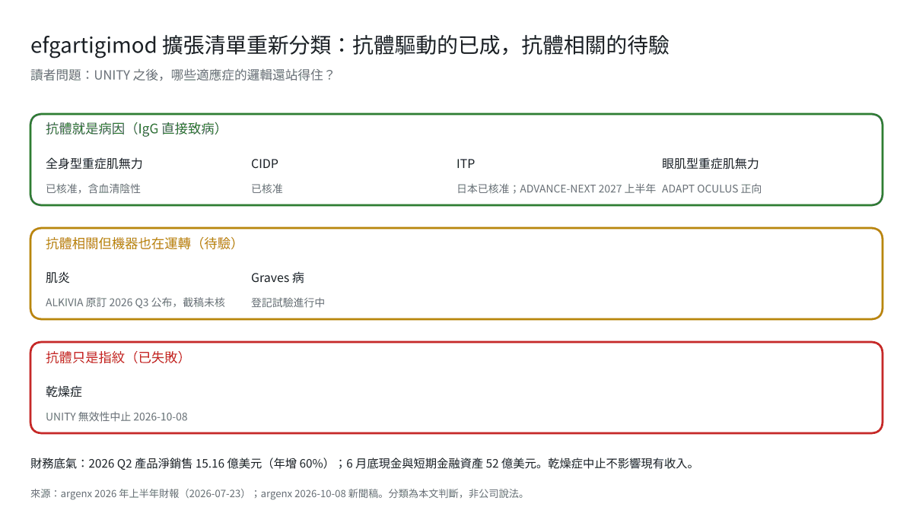

乾燥症三期喊停，argenx 押錯的是機制不是藥

2026 年 10 月 8 日，argenx 宣布中止 efgartigimod 皮下劑型在乾燥症（Sjögren's disease）的第三期 UNITY 試驗。獨立資料監測委員會在期中分析後建議「因無效性停止」，結論是這項試驗無法達到主要終點。公司原本預計 2027 年下半年才會有結果，現在提前一年出局。[1][2]

同一天，argenx 也公布了 FB102 在乳糜瀉第二期的正向結果。市場看到的是「一勝一敗」，但對投資人真正重要的是另一個問題：efgartigimod 在重症肌無力、CIDP、ITP 都成功，為什麼到了乾燥症就失靈？答案指向 argenx 整個擴張清單的篩選邏輯，而不只是一個適應症。[3]

*圖1｜三種機制攻乾燥症，只有直接動 B 細胞與 T–B 共刺激的達標*

## 01｜三週內，三家公司給了乾燥症三個答案

乾燥症是第二常見的風濕免疫病，美國估計有 100 萬到 400 萬名患者，九成是女性，三到四成血清抗體陰性。幾十年來沒有一款針對病因的藥獲准：rituximab 在 TEARS 與 TRACTISS 兩項試驗都沒達到主要終點，belimumab 有訊號但沒走到核准。[4]

2026 年秋天局面突然改變。9 月 22 日，Amgen 宣布 CD40 配體拮抗劑 dazodalibep 的第三期 OASIZ 301（約 621 人，ESSDAI 至少 5 分）達到主要終點，第 48 週 ESSDAI 改善具統計與臨床意義，第 4 週就看得到變化。[5]

更早的 1 月，諾華的 ianalumab 拿到 FDA 突破性療法認定。它的兩項第三期 NEPTUNUS-1 與 NEPTUNUS-2 都達標，第 48 週 ESSDAI 下降 6.4 分對安慰劑 5.1 分、6.5 分對 5.5 分，病人整體評估也首次在乾燥症三期出現正向結果。諾華計畫 2026 年起向各國送件。[4][6]

然後是 10 月 8 日的 argenx。三個結果擺在一起，差別不在公司規模或試驗設計，而在三種藥各自動了免疫系統的哪一層。

## 02｜efgartigimod 動的那一層，在乾燥症不是病因

efgartigimod 的機制是阻斷 FcRn，讓血中 IgG 加速分解。它在重症肌無力有效，因為那個病的病因就是一群攻擊乙醯膽鹼受體的 IgG 抗體；把 IgG 拉低，症狀就改善。CIDP 與 ITP 的邏輯相同：抗體就是兇手，清掉抗體病就退。[7]

乾燥症不一樣。病人體內確實有 anti-Ro/SSA 等自體抗體，UNITY 也只收抗體陽性的病人；但腺體裡真正造成破壞的，是持續活化的 B 細胞與 T 細胞在淚腺、唾液腺裡聚集、增生、分泌發炎物質。抗體更像這個過程留下的指紋，不是扣扳機的手。[4]

ianalumab 直接清除 B 細胞，同時封住 BAFF 受體，讓 B 細胞清掉之後長不回來。dazodalibep 擋住 CD40L，切斷 T 細胞給 B 細胞的活化訊號。兩者都動到「製造發炎的機器」。efgartigimod 只處理機器的產品，機器還在運轉。這就是為什麼同樣鎖定抗體陽性病人，一個達標、一個達標、一個中途喊停。[4][5][7]

*圖2｜2026 年乾燥症三張成績單的時間線*

argenx 的醫學長 Luc Truyen 在聲明裡說，乾燥症是「免疫學裡最異質、最複雜的疾病之一」。這句話說對了一半；另一半是，異質的疾病更需要在三期之前先證明機制抓對了層。UNITY 沒有公開的第二期乾燥症數據可以回頭對照，這一點在期中就被無效性分析放大。[1]

## 03｜對 argenx 的影響：少一個市場，多一個問題

先看帳面。argenx 2026 年第二季產品淨銷售 15.16 億美元，年增 60%；上半年 28.13 億美元；6 月底現金與短期金融資產 52 億美元。乾燥症中止不會動到任何一條現有收入，也不會改變 Vision 2030「治療 5 萬名病人」的路徑。[8]

真正被動到的，是市場給 argenx 的「一個產品、多個適應症」估值邏輯。efgartigimod 的擴張清單包括眼肌型重症肌無力（已正向）、肌炎（ALKIVIA，原訂 2026 年第三季公布）、原發性 ITP（2027 上半年）、Graves 病（登記試驗進行中）。UNITY 的結果等於告訴投資人：這張清單要重新分類，哪些是抗體驅動、哪些只是抗體相關。[8]

肌炎是最靠近的下一題。皮肌炎與多發性肌炎有一群特異性自體抗體，但肌肉破壞同樣牽涉 T 細胞浸潤與補體。如果 ALKIVIA 也達標，乾燥症就是一次個案；如果不達標，市場會把 efgartigimod 的天花板畫在「純抗體病」。這是接下來三個月 argenx 最重要的一個數字。[8]

*圖3｜三款藥在乾燥症的 ESSDAI 數字：有數字的達標，沒數字的中止*

## 04｜乾燥症市場誰拿走：諾華先到，Amgen 跟上，J&J 還在路上

對乾燥症這個市場，10 月 8 日之後的格局是兩家領先、一家觀望。諾華 ianalumab 有兩項三期與突破性認定，2026 年送件，可能成為第一個獲准的病因治療。Amgen dazodalibep 三期達標，低系統活性族群的 OASIZ 303 預計 2026 年第四季完成，若也達標，適用人群會比諾華寬。[5][6]

還有一家要盯：嬌生的 nipocalimab 與 efgartigimod 同屬 FcRn 阻斷劑，乾燥症三期結果預計 2026 年底到 2027 年初。如果嬌生也失敗，FcRn 在乾燥症的故事就結束；如果嬌生成功，argenx 要解釋的就不只是機制，還有自己的試驗設計。[4]

對台灣讀者，乾燥症（修格蘭氏症）是風濕科常見門診病，長期只有人工淚液、唾液刺激劑與免疫抑制劑可用。第一個病因治療的定價與給付，會是 2027 年健保與原廠談判的新題目；台灣臨床試驗中心若在 OASIZ 303 或 nipocalimab 三期有收案，也會在數據公布時被點名。

*圖4｜efgartigimod 擴張清單重新分類：抗體驅動的已成，抗體相關的待驗*

## 05｜接下來看什麼

三個事件會決定這篇文章的判斷是否成立。第一，argenx 10 月 22 日第三季財報是否同時交出 ALKIVIA 肌炎數據，以及管理層如何重新描述擴張清單。第二，諾華 ianalumab 的送件時間與 FDA 審查時程，決定第一個乾燥症病因藥何時上市。第三，嬌生 nipocalimab 的乾燥症三期，決定 FcRn 這一層在乾燥症是「argenx 做錯」還是「機制本身不對」。

UNITY 的中止不是 argenx 的財務事件，是一次機制分類的修正。藥沒有變差，是這個病不照藥的邏輯生病。

## 參考資料

1. argenx, "argenx Provides Update on Phase 3 UNITY Study of Efgartigimod SC in Sjögren's Disease," GlobeNewswire, 2026-10-08. https://www.globenewswire.com/news-release/2026/10/08/3376934/0/en/argenx-provides-update-on-phase-3-unity-study-of-efgartigimod-sc-in-sj%C3%B6gren-s-disease.html
2. EU Clinical Trials Information System, UNITY trial record 2024-516609-22-00. https://ctis.eu/trial/2024-516609-22-00
3. argenx, "argenx Announces Positive Topline Results from Phase 2 Study of FB102 in Celiac Disease," GlobeNewswire, 2026-10-08. https://www.globenewswire.com/news-release/2026/10/08/3376936/0/en/argenx-announces-positive-topline-results-from-phase-2-study-of-fb102-in-celiac-disease.html
4. Rheumatology Live, "From Rituximab to Ianalumab: The Evolution of Targeted Therapy in Sjögren Disease," 2026-04-30. https://www.rheum-live.com/view/rituximab-to-ianalumab-evolution-targeted-therapy-sjogren-disease
5. BioPharm International, "Amgen's Dazodalibep Meets Primary Endpoint in Phase 3 Sjögren's Trial," 2026-09-23（引述 Amgen 2026-09-22 新聞稿）. https://www.biopharminternational.com/view/amgen-dazodalibep-primary-endpoint-phase-3-sjogrens-trial
6. Novartis, "Novartis ianalumab receives FDA Breakthrough Therapy designation for Sjögren's disease," 2026-01-16. https://www.novartis.com/news/media-releases/novartis-ianalumab-receives-fda-breakthrough-therapy-designation-sjogrens-disease
7. Life Science Daily News, "Clinical Trial Results 9 October 2026 Roundup." https://lifesciencedaily.news/clinical-trial-results-9-october-2026/
8. argenx, "argenx Reports Half Year 2026 Financial Results and Provides Second Quarter Business Update," 2026-07-23. https://argenx.com/news/2026/press-release-3331862.html
