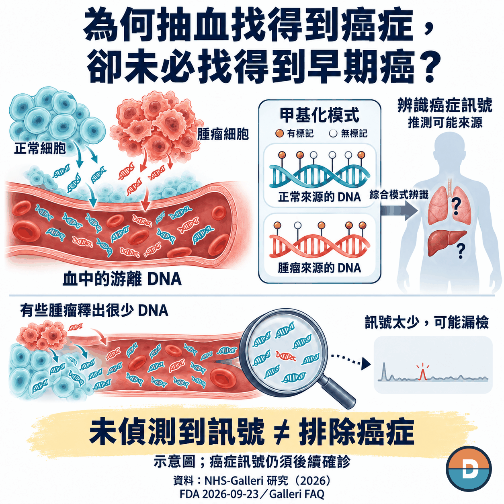
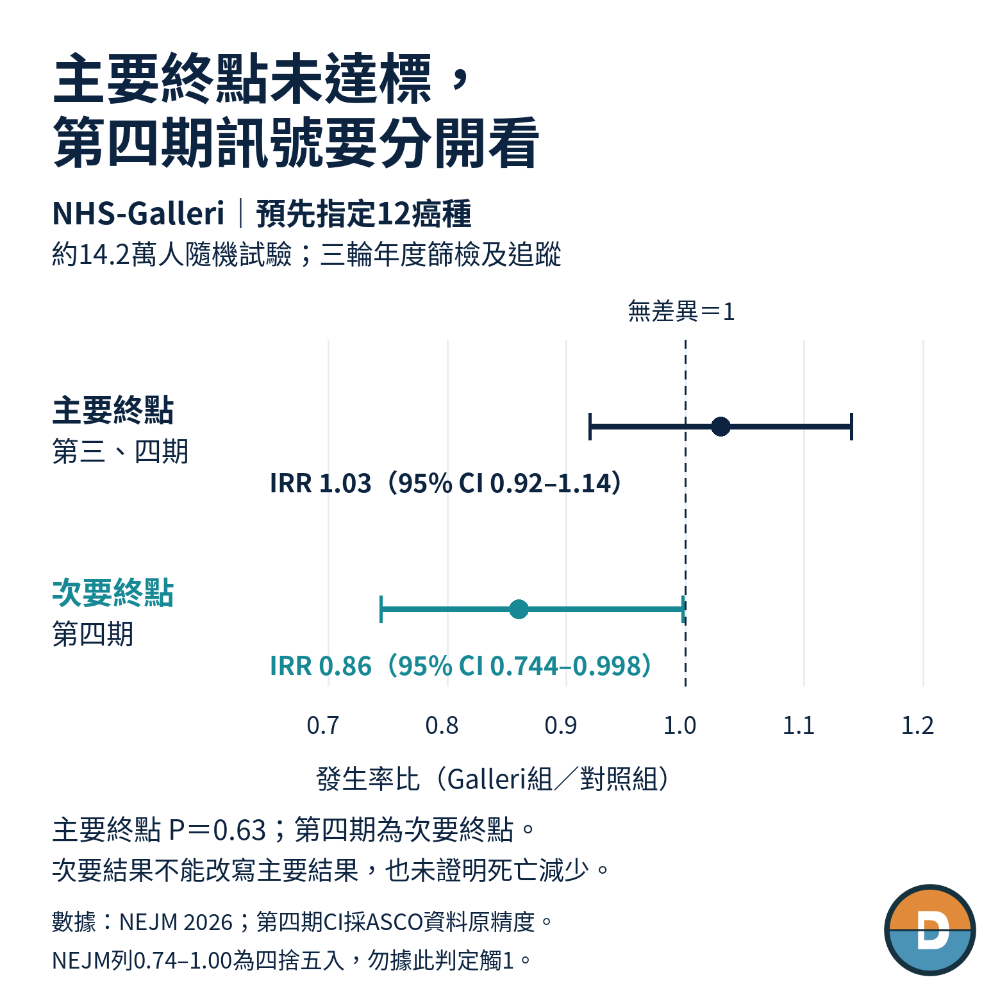
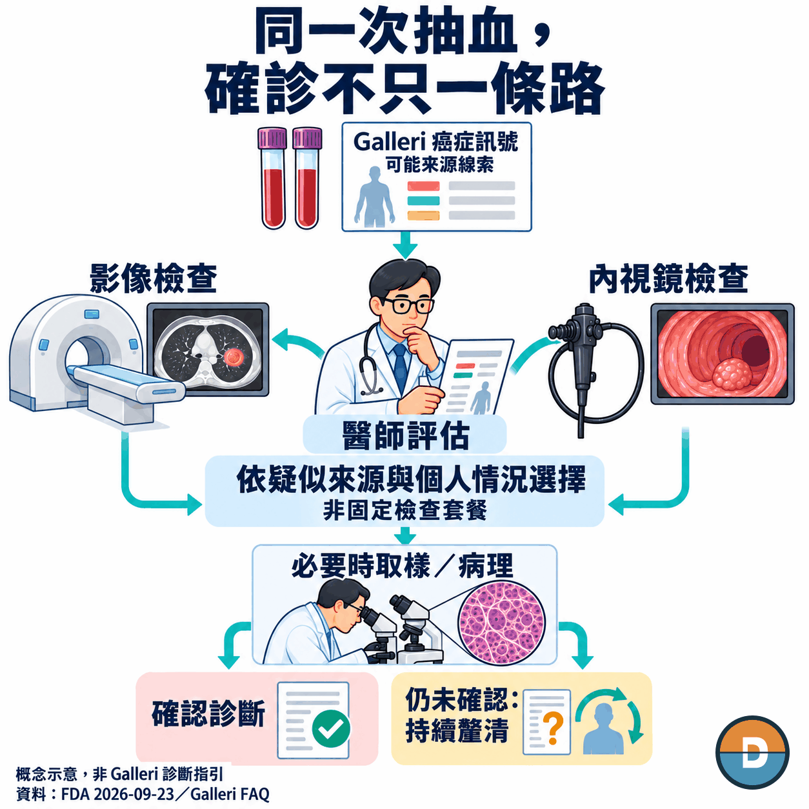

# Has Cancer Detection from a Blood Sample Really Arrived?

A few drops of blood from a fingertip, enough to perform a wide range of clinical tests. Silicon Valley startup Theranos once used that promise to attract investors, only to end up at the center of a fraud case. In 2022, founder Elizabeth Holmes was sentenced to 11 years and three months in prison on charges related to defrauding investors.

Now another company, GRAIL, is bringing blood testing into cancer screening. Its Galleri test actually uses a venous blood draw, with a standard collection of two tubes containing 10 milliliters each, and looks for signals of multiple cancers in DNA circulating in the blood. The product is already selling, with more than 60,000 tests in a quarter. The question now is whether the cancers it finds are being found early enough.

On September 23, 2026, FDA advisory committee members voted 6–4 in favor of Galleri's effectiveness, and a majority also voted that its benefits outweighed its risks. But the UK NHS-Galleri trial, involving approximately 142,000 people, did not meet its primary endpoint combining stage III and stage IV cancers. Having a test and receiving orders are different achievements from demonstrating fewer late-stage cancers across a population.

According to the FDA meeting summary, committee members broadly expressed concerns about the word “early.” Some favorable votes came with conditions, including removing that word and conducting additional studies. The vote was advisory. GRAIL's October 5 announcement still explicitly stated that Galleri had not been cleared or approved by the FDA.

The company is pursuing a path that starts with customers willing to pay, then seeks to bring larger healthcare payment systems on board. The question in between is what the word “early” can deliver for payers.

*Figure 1 | Three FDA advisory committee votes: majority support, but the “early” claim remains in question; an advisory vote is not formal approval*

## 01 | When a cancer is small, clues in the blood may also be scarce

Galleri aims to address a real gap. Many cancers lack routine screening tools, and by the time symptoms appear, opportunities for earlier intervention have often been missed. If one blood draw could detect multiple cancers, there would be less need to decide in advance which organ to investigate.

The test reads cell-free DNA in the blood. Both normal cells and cancer cells can release DNA fragments. Galleri looks through that mixture for methylation patterns associated with cancer.

Methylation consists of chemical marks on DNA. Their distribution differs across tissues and cell states. These patterns offer two kinds of clues: whether a suspicious cancer signal is present, and which tissue or organ it may come from.

The difficulty is that some tumors release very little DNA, and small, early-stage lesions may not produce enough signal. The data reviewed by FDA committee members showed that Galleri's overall detection of stage I cancers was lower than its detection of stage II through IV cancers. Finding a cancer before symptoms emerge still does not mean that most cancers can be found at stage I.

*Figure 2 | From cell-free DNA to methylation patterns: why early-stage cancers may be missed; no detected signal does not rule out cancer*

This makes the randomized NHS-Galleri trial particularly important. The study divided approximately 142,000 people into screening and control groups, with three rounds of annual screening and follow-up. It examined whether adding Galleri could reduce the incidence of stage III and IV diagnoses across 12 prespecified cancers.

The paper published in September confirmed that the primary endpoint was not met: the incidence rate ratio was 1.03, with a 95% confidence interval of 0.92 to 1.14 and a P value of 0.63. The trial did not show that Galleri reduced this combined late-stage endpoint.

For the key secondary endpoint of stage IV disease in the same group of cancers, the incidence rate ratio was 0.86. The ASCO fact sheet reported the 95% confidence interval at its original precision of 0.744 to 0.998, reaching nominal statistical significance. That direction warrants follow-up, but it does not reverse the primary endpoint failure or directly demonstrate a reduction in cancer deaths.

For GRAIL, the challenge goes beyond finding more cancers. If the aim is to draw blood annually from large numbers of people without symptoms, payers will also ask how many people avoid late-stage disease because of those additional diagnoses. That answer remains incomplete, so test sales alone cannot make the case for a broader customer base.

*Figure 3 | NHS-Galleri endpoints: the primary combined stage III and IV endpoint was not met; the stage IV secondary endpoint was only nominally significant, with no demonstrated mortality reduction*

## 02 | Why can Galleri be sold before FDA approval?

Galleri is currently offered in the United States as a laboratory-developed test, or LDT. In its second-quarter filing, GRAIL explained that current sales do not depend on obtaining FDA approval. Samples are processed in its CLIA-compliant, CAP-accredited laboratory. Those laboratory qualifications and FDA marketing authorization for a product are different levels of requirements.

The company can therefore accept self-pay orders while also working with self-insured employers and some health plans. The website lists a price of $949, with a patient self-pay price of $799 for qualifying ordering routes. Some employers and life insurers provide full or partial benefit coverage. Galleri has not secured broad coverage from Medicare or major commercial health insurers.

This route is already generating revenue. Second-quarter Galleri test volume exceeded 61,000, up 35% year over year, while testing revenue reached $42.6 million, up 24%. Volume growth did not translate into an equivalent rise in revenue: the filing for the same quarter reported an 8% year-over-year decline in average selling price.

The company also disclosed that negotiated pricing and discounts for large customers and international distributors, among other arrangements, affect revenue per test. Winning more orders can spread laboratory equipment and operating costs across more samples. Landing a large customer, however, does not mean that every order will command the website's listed price.

That is the trade-off in GRAIL's current market approach. The company can build orders and experience with the test, but growth remains constrained by what buyers are willing to pay and who has access to benefits that help cover the cost. To reach a broader screening population, GRAIL is still seeking FDA approval, giving large payers an opportunity to formally evaluate coverage.

Section 6221 of Public Law 119-75, enacted on February 3, 2026, opened a window for that process: beginning January 1, 2029, qualifying multi-cancer early detection tests can pursue coverage through a Medicare pathway.

The requirements include FDA marketing authorization and a CMS national coverage determination finding the test reasonable and necessary for appropriate beneficiaries, along with age and testing-interval conditions. The law is in place, but Galleri has not yet qualified. Even FDA approval would not guarantee subsequent coverage. The next potential large buyers still have to judge whether the evidence is worth paying for.

## 03 | The price of a blood test is not the full screening bill

As payment shifts from individual self-pay customers to entire populations, costs beyond the test become harder to leave out.

In the first round of NHS-Galleri, 722 participants had a cancer signal detected, and 419 were subsequently confirmed to have a primary cancer, giving a positive predictive value of approximately 58%. A positive report can only suggest where to look. Physicians must still arrange imaging, endoscopy, or, where necessary, tissue sampling and pathology, based on the predicted origin and the individual's circumstances.

This means that a testing budget also needs healthcare resources capable of completing the diagnosis. How many people with positive results ultimately have no cancer found, how many investigations they undergo, and how long they wait all affect the burden of expanding screening. A negative result cannot rule out cancer either, and previously recommended cancer screening must continue.

Competitor Guardant Health's Shield takes a narrower route. Approved by the FDA in July 2024, it focuses on colorectal cancer screening in average-risk adults aged 45 and older, with a positive result followed by colonoscopy for confirmation.

Galleri's choice to cover multiple cancers at once addresses more screening gaps, while also extending follow-up questions across different organs and specialties. The products serve different purposes, so their accuracy cannot be directly ranked across studies. The diagnostic arrangements they require buyers to support are different from the outset.

Alongside waiting for longer-term disease outcomes, GRAIL therefore needs to measure the care journeys of people who already have positive results. Such data can help hospitals and health plans estimate the resources required for adoption, moving the discussion from buying a single test to deciding whether the service can be offered year after year.

*Figure 4 | The diagnostic pathway after a positive signal: physician assessment, investigations selected for the circumstances, and tissue sampling and pathology when needed; not a fixed package of tests*

## 04 | Samsung's funding keeps another market route moving

While evidence and coverage decisions are pending, GRAIL still has a business to run. The company reported a second-quarter net loss of $110.2 million and ended the quarter with $861.6 million in cash and short-term investments. Net loss includes research and development, commercialization, accounting amortization, and other items; it is neither a loss per test nor the quarter's cash outflow.

On June 25, GRAIL completed a total of $110 million in equity investment from Samsung-affiliated entities. The announcement linked the funding to the US approval and reimbursement process and international expansion. The collaboration envisages commercialization in South Korea and exploration of potential opportunities in Japan and Singapore, subject to regulatory and other conditions.

One detail in the arrangement deserves attention: initial testing will be processed at GRAIL's laboratory in North Carolina, in the United States.

Under this arrangement, the Asian collaboration can initially use the existing US laboratory. From a commercial perspective, GRAIL can pursue large US payers while preparing an overseas entry route. But a laboratory's ability to issue reports does not automatically resolve local market access, payment, or care after a positive result. How far the partnership brings the company toward orders still depends on what each market completes next.

On October 5, GRAIL announced plans to present data at ESMO sessions on October 25 and 26 on cancer-signal-directed diagnostic pathways and diagnostic investigations in clinical practice. As of October 12, those presentations were still pending.

The question to watch in these data is how much time and how many investigations hospitals need to turn a Galleri signal into a diagnosis. Better pathways may ease the burden of adoption for healthcare providers. They still cannot fill the gap left by the failure to meet the primary late-stage endpoint.

GRAIL can use diagnostic data to help partners decide how to handle more tests. To make “early” a reason for large-scale, sustained payment, it still needs to persuade payers with evidence on late-stage disease and longer-term health outcomes. Current orders can continue. How far the next step takes the company depends on which kind of evidence it delivers.

*This article is an analysis of the industry and company and does not constitute investment or medical advice.*

*本文為產業與公司分析，不構成投資或醫療建議。*

## References

1. FDA, September 23, 2026. Galleri advisory committee summary: votes, the term “early,” and boundaries of use. https://www.fda.gov/media/195032/download
2. NEJM. NHS-Galleri randomized trial: primary and stage IV secondary endpoints. https://www.nejm.org/doi/full/10.1056/NEJMoa2505723
3. Nature Medicine, September 22, 2026. NHS-Galleri test performance: first-round positive results, confirmed cancers, and the methylation principle. https://www.nature.com/articles/s41591-026-04652-8
4. Galleri. Healthcare professional FAQs: technology, pricing, payment, and intended use. https://www.galleri.com/hcp/faqs
5. GRAIL, August 5, 2026. Second-quarter financial results: Galleri volume and revenue, company net loss, and cash. https://investors.grail.com/news-releases/news-release-details/grail-reports-second-quarter-2026-financial-results
6. Public Law 119-75, Section 6221, 140 STAT 661–663. Conditional coverage pathway beginning in 2029. https://www.govinfo.gov/content/pkg/PLAW-119publ75/html/PLAW-119publ75.htm
7. FDA. Shield original PMA P230009: July 26, 2024 decision and indications for use. https://www.accessdata.fda.gov/scripts/cdrh/cfdocs/cfpma/pma.cfm?id=P230009
8. GRAIL, June 25, 2026. Completion of $110 million in equity financing from Samsung entities and regional collaboration. https://investors.grail.com/news-releases/news-release-details/grail-completes-110-million-equity-financing-samsung-entities
9. GRAIL, October 5, 2026. Conference presentation announcement and product statement that Galleri has not received FDA clearance or approval. https://grail.com/press-releases/grail-to-present-new-data-from-nhs-galleri-and-pathfinder-2-at-edcc-and-esmo-congress-2026/
10. GRAIL. 2026 ASCO NHS-Galleri fact sheet, page 1: stage IV confidence interval at its original precision. https://grail.com/wp-content/uploads/2026/05/NHS-GalleriASCO_Factsheet_FINAL.pdf
11. GRAIL. Second-quarter 2026 Form 10-Q, Management's Discussion and Analysis: current LDT sales, buyers and coverage status, quarterly volume, pricing and revenue changes, and expense definitions. https://investors.grail.com/node/8736/html
12. US Department of Justice. U.S. v. Elizabeth Holmes, et al.: Theranos testing claims and Holmes's 2022 investor-fraud conviction and sentencing. https://www.justice.gov/usao-ndca/us-v-elizabeth-holmes-et-al
13. US Securities and Exchange Commission, March 19, 2018. Litigation Release No. 24069: Theranos's claims about testing small finger-prick blood samples and litigation announcement. https://www.sec.gov/enforcement-litigation/litigation-releases/lr-24069
14. GRAIL. Galleri Labeling + collecting a specimen, pages 1–2: venous collection and the standard two tubes of 10 mL each. https://assets.galleri.com/statics/Downloads/Galleri_Labeling_and_Collecting_ver2_Final.pdf
