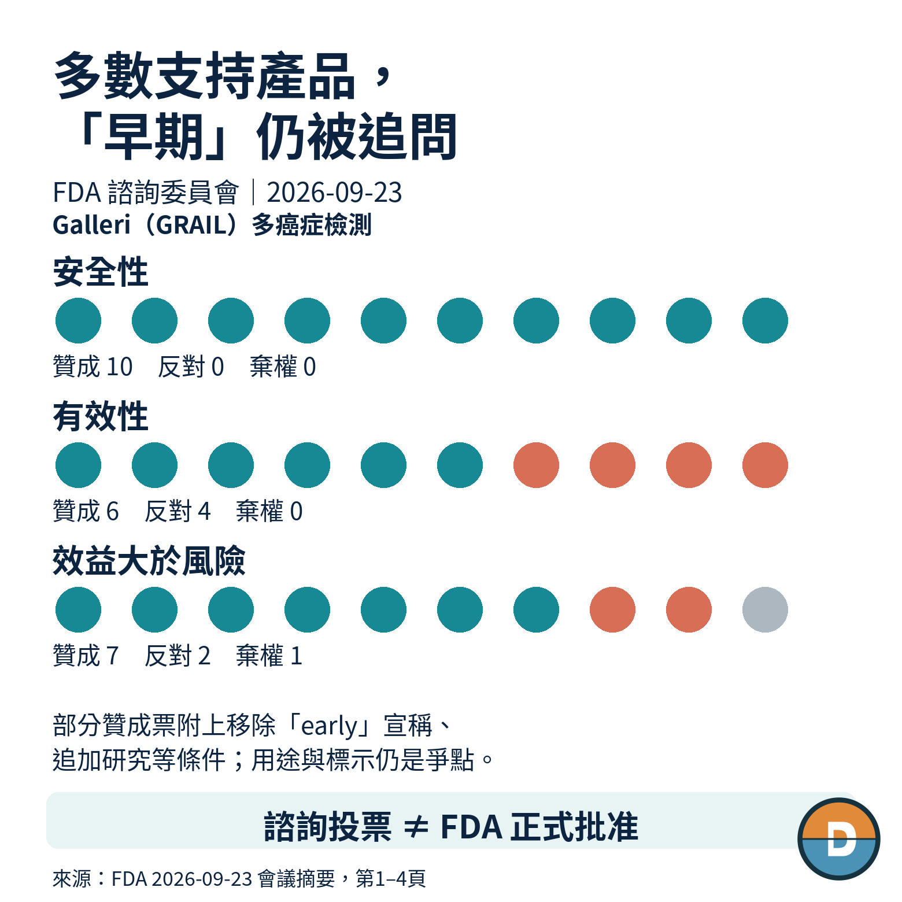
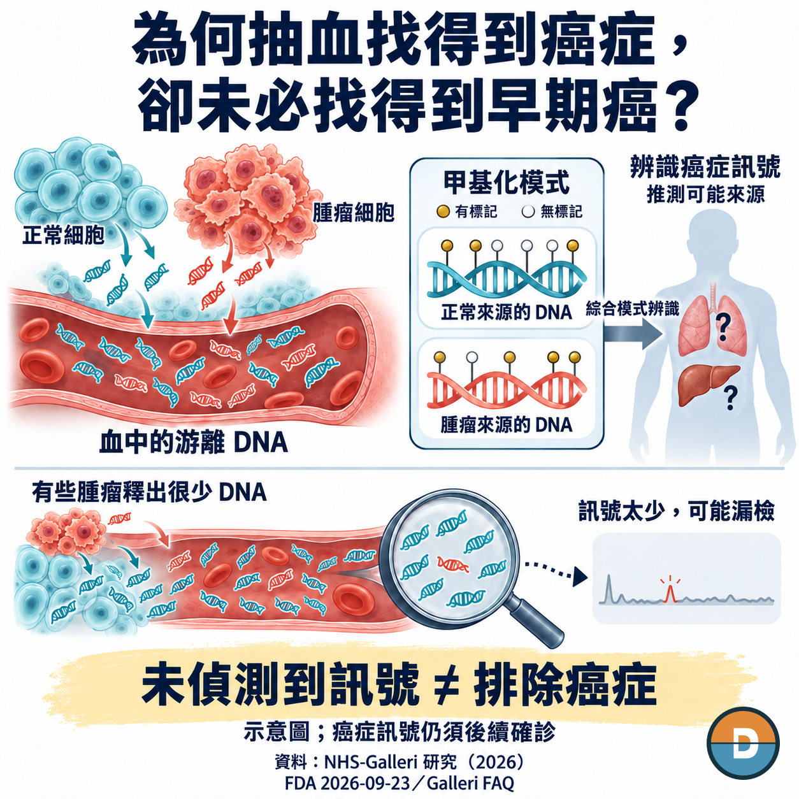
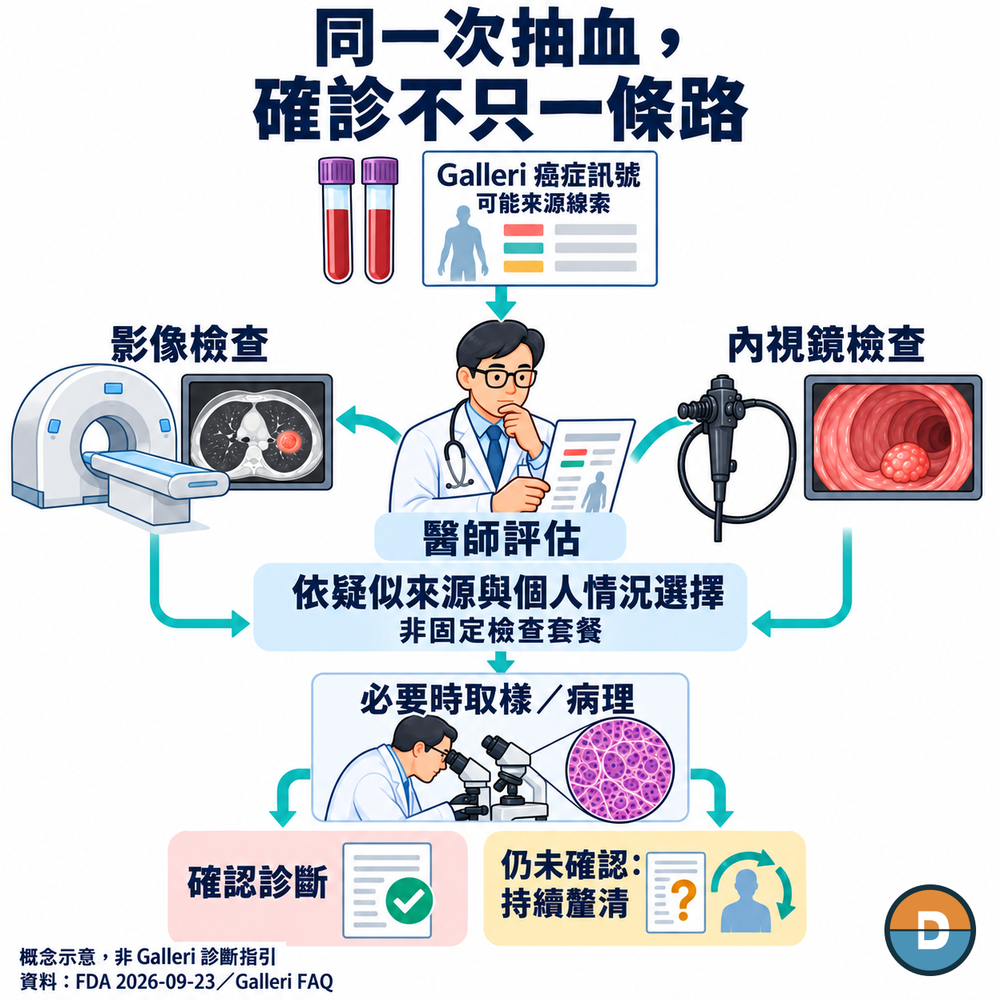

# 滴血驗癌真的來了？

從指尖取幾滴血，就能完成多種臨床檢驗。矽谷新創 Theranos 曾用這個承諾吸引投資人，最後卻走進詐欺案。2022年，創辦人 Elizabeth Holmes 因詐騙投資人相關罪名，被判刑11年3個月。

如今，另一家公司 GRAIL 正把抽血檢測帶進癌症篩檢。它的 Galleri 實際使用靜脈抽血，標準採集兩管、每管10毫升，再從血液中的 DNA 尋找多種癌症訊號。產品已經賣起來，一季檢測量超過六萬次；現在要回答的，是癌症找到了，究竟夠不夠早？

2026年9月23日，FDA 諮詢委員以6比4支持 Galleri 的有效性，對效益大於風險也投下多數贊成票。但約14.2萬人參與的英國 NHS-Galleri 試驗，主要的第三、第四期癌症合併終點並未達標。有檢測、有訂單，與證明它能讓族群少一點晚期癌症，仍是不同的成績。

依 FDA 會議摘要，委員普遍對「early」用語有疑慮，部分贊成票附上移除這個字、追加研究等條件。這場投票是諮詢意見；GRAIL 的10月5日公告仍明列，Galleri 尚未獲 FDA 許可或批准。

公司正在走的路，是先服務願意付費的客戶，再爭取讓更大的醫療支付體系接手。卡在中間的，正是這個「早」字能替付款人換到什麼。

*圖1｜FDA 諮詢委員會三項投票：多數支持，但「early」宣稱仍被質疑；諮詢投票不等於正式批准*

## 01｜癌症還小，血裡的線索也可能太少

Galleri 想解決一個真實缺口：不少癌症沒有常規篩檢工具，等症狀出現，往往已經錯過更早處理的機會。一次抽血若能同時找到多種癌症，就不必先猜該檢查哪個器官。

它讀的是血液中的游離 DNA。正常細胞與癌細胞都可能釋出 DNA 碎片，Galleri 從混在一起的碎片裡，找出與癌症相關的甲基化模式。

甲基化是 DNA 上的化學標記。不同組織、不同細胞狀態，標記的分布不同；這些模式提供了兩種線索：有沒有可疑的癌症訊號，以及可能來自哪個組織或器官。

難處在於，有些腫瘤釋放的 DNA 很少，早期的小病灶也未必送出足夠訊號。FDA 委員看到的資料顯示，Galleri 對第一期癌症的偵測，整體不如第二至第四期。能比症狀出現更早發現癌症，仍不等於多數癌症都能在第一期被找到。

*圖2｜從血中游離 DNA 到甲基化模式：為何早期癌可能漏掉；未偵測到訊號不能排除癌症*

這讓 NHS-Galleri 的隨機試驗格外重要。研究把約14.2萬人分成篩檢與對照兩組，進行三輪年度篩檢並追蹤，要看預先指定12種癌症的第三、第四期診斷發生率，能否因加入 Galleri 而下降。

9月刊出的論文確認，主要終點未達標：發生率比1.03，95%信賴區間0.92至1.14，P值0.63。這次試驗沒有顯示，Galleri 讓這個合併晚期終點減少。

同一組癌症的第四期關鍵次要終點，發生率比為0.86；ASCO 資料表保留的95%信賴區間是0.744至0.998，達名目統計顯著。這個方向值得追蹤，但不能改寫主要終點失利，也沒有直接證明癌症死亡減少。

對 GRAIL 而言，困難不只是找到更多癌症。若希望每年替大批沒有症狀的人抽血，付款人還會問：多找出來的診斷，究竟讓多少人避開晚期疾病？這份答案目前仍有缺口，擴大客群便不能只靠檢測銷量說服人。

*圖3｜NHS-Galleri 終點：主要第三、四期合併終點未達標，第四期次要終點僅名目顯著，未證明死亡減少*

## 02｜還沒拿到 FDA 核准，為何已經能賣？

Galleri 目前在美國以實驗室開發檢測，也就是 LDT，提供服務。GRAIL 在第二季申報文件中說明，現行銷售不以取得 FDA 核准為前提；檢體由其符合 CLIA 要求、取得 CAP 認證的實驗室處理。這些實驗室資格，與 FDA 對產品作出的市場許可是不同層次的要求。

因此，公司可以先接自費訂單，也與自保雇主及部分健康保險計畫合作。官網列價949美元，符合指定開單方式的病人自費價為799美元；部分雇主、壽險業者提供全額或部分福利支付。Galleri 尚未取得廣泛的 Medicare 與大型商業健康保險給付。

這條路已經帶來收入。第二季 Galleri 檢測量超過61,000次、年增35%，檢測收入4,260萬美元、年增24%。不過，量增沒有等幅變成收入：同一季申報文件列出的平均售價，年減8%。

公司也揭露，大客戶、國際經銷商的議價及折扣等安排，會影響每次檢測的收入。爭取更多訂單，可以把實驗室設備與營運成本分攤到更多檢體；接到大客戶，卻不代表每一單都能按官網價格收錢。

這就是現階段市場選擇的代價：GRAIL 能先累積訂單與使用經驗，成長卻仍受買方願付多少、哪些人有福利補助所限制。要把服務推向更廣的受檢族群，公司仍在爭取 FDA 核准，讓大型付款人有機會正式評估納入給付。

2026年2月3日成法的 Public Law 119-75，第6221節，替這件事開了一個時間窗口：自2029年1月1日起，符合條件的多癌症早期偵測可循 Medicare 路徑爭取給付。

門檻包括 FDA 市場許可，以及 CMS 透過全國給付決定，認定對適當受益人屬合理且必要，另有年齡與檢測間隔條件。法律有了，Galleri 的資格還沒拿到；即使取得 FDA 核准，也不保證後續給付。下一批可能的大買方，仍要自己判斷證據值不值得付錢。

## 03｜一次抽血的報價，還不是篩檢的總帳單

當支付從個人自費走向整個族群，檢測之外的費用就更難略過。

NHS-Galleri 第一輪有722人驗出癌症訊號，後續419人確認原發癌症，陽性預測值約58%。陽性報告只能提示往哪裡找；醫師仍須依可能來源與個人情況，安排影像、內視鏡，或必要的取樣與病理檢查。

這意味著，買下檢測的預算之外，還需要能完成診斷的醫療資源。多少陽性者最後沒有找到癌症、用了多少檢查、等待多久，都會改變擴大篩檢的負擔。陰性也不能排除癌症，原本建議的癌症篩檢仍須繼續。

競爭者 Guardant Health 的 Shield，選的是較窄的入口：2024年7月獲 FDA 核准，聚焦45歲以上、平均風險成人的大腸直腸癌篩檢，陽性後接大腸鏡確認。

Galleri 選擇一次涵蓋多種癌症，能碰到更多篩檢空白，也把後續問題帶進不同器官與專科。兩項產品的用途不同，不能跨研究直接比誰比較準；它們讓買方承接的診斷安排，本來就不同。

所以，GRAIL 除了等待更長期的疾病結果，還得把現有陽性者的就醫過程量清楚。這類資料能幫醫院與保險計畫估算導入所需的資源，讓原本只買一次檢測的討論，走到是否能年年提供服務的決策。

*圖4｜陽性訊號之後的診斷流程：醫師評估、依情況選檢查、必要時取樣病理；非固定檢查套餐*

## 04｜三星的資金，讓另一條市場路線繼續走

等待證據與支付決定的同時，GRAIL 仍有一家公司要經營。第二季全公司淨損1.102億美元，季末現金及短期投資8.616億美元；淨損包括研發、商業化與會計攤銷等項目，並非每次檢測的虧損或當季現金流出。

6月25日，GRAIL 完成三星關係企業合計1.1億美元的股權投資。公告把這筆資金連到美國核准、給付進程與國際市場拓展，合作則規劃在南韓商業化，並探索日本、新加坡的潛在機會，仍須滿足監管及其他條件。

安排中有一個值得注意的細節：初期檢測會交給 GRAIL 在美國北卡羅來納州的實驗室處理。

依這個安排，亞洲合作初期便可沿用既有的美國實驗室。從商業安排看，公司可以一邊爭取美國的大型付款人，一邊準備海外入口；但實驗室能出報告，並不會自動解決當地准入、付款與陽性後就醫的問題。合作能把訂單帶近哪一步，仍取決於各市場接下來完成什麼。

10月5日，GRAIL 預告將在10月25、26日的 ESMO 場次，發表癌症訊號引導的後續診斷流程，以及臨床實務中的診斷檢查資料。截至10月12日，這些仍待發表。

這批資料值得看的是：醫院要花多少時間與檢查，才能把 Galleri 的訊號追成診斷。流程若改善，可能降低醫療機構導入的負擔；它仍不能補上主要晚期終點未達標留下的缺口。

GRAIL 可以用診斷資料，協助合作方決定如何接更多檢測；要讓「早」成為大規模、持續支付的理由，還得用晚期疾病與更長期的健康結果說服付款人。眼前的訂單能繼續做，下一步能走多大，取決於公司交出的是哪一種證據。

*本文為產業與公司分析，不構成投資或醫療建議。*

## 參考資料

1. FDA，2026-09-23，Galleri 諮詢委員會摘要：投票、early 用語及使用界線。 https://www.fda.gov/media/195032/download
2. NEJM，NHS-Galleri 隨機試驗：主要及第四期次要終點。 https://www.nejm.org/doi/full/10.1056/NEJMoa2505723
3. Nature Medicine，2026-09-22，NHS-Galleri 檢測表現：首輪陽性、確認癌症及甲基化原理。 https://www.nature.com/articles/s41591-026-04652-8
4. Galleri，醫療人員 FAQ：原理、價格、支付及用途。 https://www.galleri.com/hcp/faqs
5. GRAIL，2026-08-05，第二季財報：Galleri 檢測量及收入、公司淨損與現金。 https://investors.grail.com/news-releases/news-release-details/grail-reports-second-quarter-2026-financial-results
6. Public Law 119-75，第6221節，140 STAT 661–663：2029年起的條件給付路徑。 https://www.govinfo.gov/content/pkg/PLAW-119publ75/html/PLAW-119publ75.htm
7. FDA，Shield 原始 PMA P230009：2024-07-26 決定及適用範圍。 https://www.accessdata.fda.gov/scripts/cdrh/cfdocs/cfpma/pma.cfm?id=P230009
8. GRAIL，2026-06-25，三星1.1億美元股權融資完成及區域合作。 https://investors.grail.com/news-releases/news-release-details/grail-completes-110-million-equity-financing-samsung-entities
9. GRAIL，2026-10-05，會議發表預告及尚未取得 FDA 許可／批准的產品聲明。 https://grail.com/press-releases/grail-to-present-new-data-from-nhs-galleri-and-pathfinder-2-at-edcc-and-esmo-congress-2026/
10. GRAIL，2026 ASCO NHS-Galleri 資料表，第1頁：第四期信賴區間原精度。 https://grail.com/wp-content/uploads/2026/05/NHS-GalleriASCO_Factsheet_FINAL.pdf
11. GRAIL，2026年第二季 Form 10-Q，Management's Discussion and Analysis：現行 LDT 銷售、買方與給付狀態、同季量價收入變化及費用口徑。 https://investors.grail.com/node/8736/html
12. 美國司法部，U.S. v. Elizabeth Holmes, et al.：Theranos 檢驗宣稱及 Holmes 於2022年的投資人詐欺定罪、判刑。 https://www.justice.gov/usao-ndca/us-v-elizabeth-holmes-et-al
13. 美國證交會，2018-03-19，Litigation Release No. 24069：Theranos 指尖少量血液檢驗的宣稱與訴訟公告。 https://www.sec.gov/enforcement-litigation/litigation-releases/lr-24069
14. GRAIL，Galleri Labeling + collecting a specimen，第1–2頁：靜脈採血與標準兩管、每管10mL。 https://assets.galleri.com/statics/Downloads/Galleri_Labeling_and_Collecting_ver2_Final.pdf
