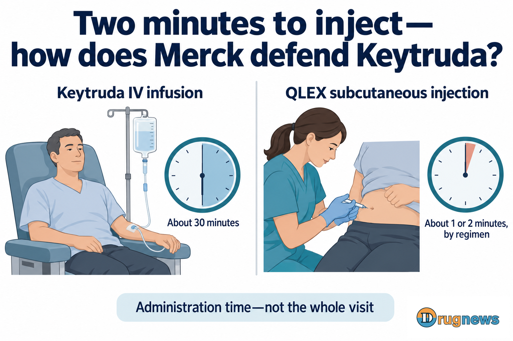
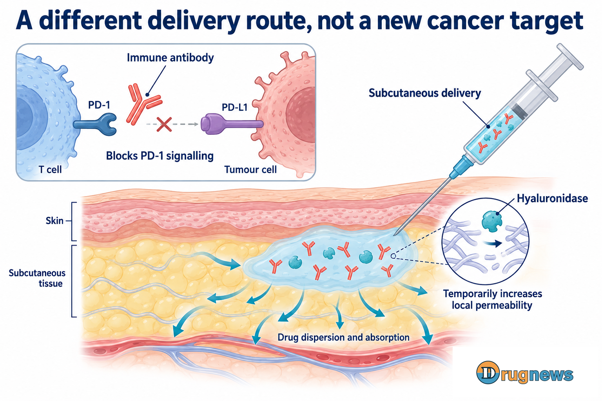
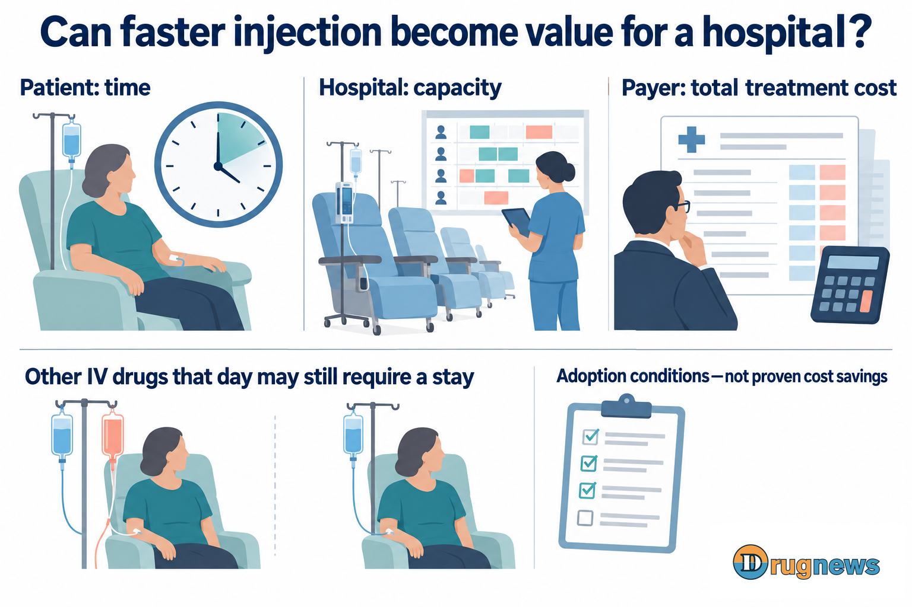
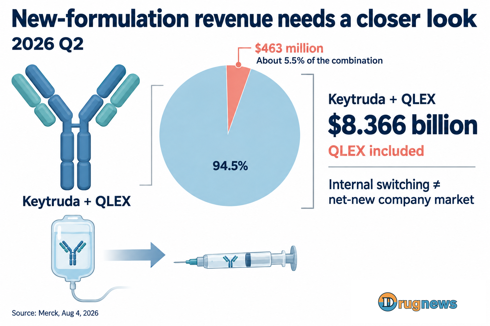

# Defending its blockbuster, Merck hits a patent wall

One drug accounts for half a company's revenue. That does not give its patents any extra years.

Merck chose South Korea's Alteogen to turn Keytruda into a more convenient subcutaneous formulation. Work on the next blockbuster must continue. For now, the company is trying to secure another chapter in the commercial life of its current mainstay.

The product was developed, and the FDA approved it. But another US company, Halozyme, now stands in the way of its launch.

On October 7, Halozyme announced that a Dutch court had issued an injunction concerning the MDASE patent EP622, restricting Merck subsidiary MSD BV from manufacturing and selling subcutaneous Keytruda in eight markets, including the Netherlands, France and Italy.

The intravenous version is not affected by this injunction. The scope described above comes from Halozyme's disclosure; the full court judgment has not been obtained.

Merck has already paid for access to its partner's technology. Why can a third company still stand in its way? And what additional costs might this injunction impose on a deal already agreed?

# 01 | Half the company's revenue cannot simply wait for the next drug

In the second quarter of 2026, Keytruda and its subcutaneous version, QLEX, generated a combined $8.366 billion in revenue, about half of Merck's revenue for the quarter.

Behind that figure is a problem a large pharmaceutical company can hardly avoid: its biggest revenue generator is approaching patent expiry, while the success of a successor drug cannot be scheduled to suit the company's needs.

Merck's 2025 annual report states that Keytruda's principal US compound patent will expire in 2028. Two other patents in the same family extend to 2029, and the company expects that they may face litigation. The listed expiry in major European markets is 2031.

The US and Europe run on different clocks. The year 2028 does not mark the simultaneous loss of all protection worldwide, nor does it establish that alternatives will appear in Europe that same year.

Finding new targets and developing new antibodies opens up future possibilities. But clinical trials, approvals and hospital adoption all take time. Competition for Keytruda will not automatically wait because a successor is not ready.

The subcutaneous version therefore became one way to defend the existing business.

Doctors already know pembrolizumab. What Merck is offering is an administration option that can make some suitable treatment regimens more convenient. The original antibody's patent clock has not restarted, but the way hospitals compare products may change.

If both options require IV infusion, price can easily become the focus. If one can save administration time in suitable regimens, purchasing decisions also need to account for nursing work, treatment space and patients' time.

Whether a new formulation can defend the business ultimately depends on what that convenience is worth inside a hospital. Benefits listed in a presentation first have to become a service the hospital wants to keep.

*Figure 1 | About one or two minutes, depending on the regimen, refers to QLEX injection time, not the whole visit. Both products contain pembrolizumab as the anticancer component.*

# 02 | One enzyme earns a share in a blockbuster business

Alteogen entered this business by opening up a path for the drug solution beneath the skin.

Pembrolizumab in Keytruda blocks PD-1 signalling on T cells, relieving some of the immune suppression caused by that pathway and giving antitumour immune responses an opportunity to function. In the subcutaneous version, the antibody remains the anticancer component.

Subcutaneous tissue, however, is not an empty pouch waiting to be filled with medicine.

The network between cells contains hyaluronan, which resists the dispersion of a drug solution. An IV infusion enters the bloodstream directly. A subcutaneous injection first has to disperse through tissue and then be absorbed.

Alteogen's hyaluronidase, berahyaluronidase alfa, temporarily breaks down hyaluronan locally, increasing tissue permeability and helping a larger volume of drug solution disperse. Its role is to improve delivery; it does not change the antibody's action in mobilising an immune response.

*Figure 2 | The antibody blocks the PD-1 pathway; hyaluronidase temporarily increases local subcutaneous tissue permeability, supporting dispersion and absorption. Mechanistic illustration, not to scale.*

Being able to inject the drug is only part of the work. Developers also have to show that the body still receives appropriate drug exposure through the different route.

The 377-patient randomised trial supporting FDA approval met its predefined drug-exposure comparability criteria. Efficacy was assessed descriptively; the trial did not show that the subcutaneous version treats cancer more powerfully.

The convenience gained from that development is concrete: a healthcare professional administers the injection in about one or two minutes, depending on the regimen, compared with an approximately 30-minute IV infusion. If the patient still needs IV chemotherapy that day, only one part of the treatment is shortened. The whole visit does not become a two-minute appointment.

In February 2024, Merck converted the previously non-exclusive collaboration into a global exclusive licence for subcutaneous pembrolizumab. Alteogen is also responsible for commercial enzyme supply.

The enzyme's compensation became tied to the blockbuster's progress.

Merck's 2025 annual report lists regulatory milestones and up to $1 billion in total annual and cumulative sales milestones under the collaboration. Royalties in the low-single-digit percentage range of net sales begin only after all sales milestones have been achieved.

Following US and EU approvals in 2025, Merck paid $40 million in regulatory milestones.

The company also considered it probable that future sales would trigger $890 million in milestones and recognised the related liabilities. That $890 million had not been paid at the time; payment remained contingent on the corresponding sales conditions being met.

Alteogen does not itself own pembrolizumab, yet it can receive compensation as the product wins approval, sells and crosses milestones. A technology company does not necessarily have to create another blockbuster. Solving a blockbuster's immediate problem can also build a substantial business.

How much do a few percentage points matter to Merck?

Consider a scenario constructed here solely to examine royalty-rate sensitivity: if annual net sales of the subcutaneous product were $10 billion, each one-percentage-point difference in royalties would amount to $100 million a year. This is an illustration of scale, not a QLEX sales forecast or savings already realised in this case.

But total costs also include earlier milestone payments, enzyme-supply charges and payment timing. Low-single-digit royalties begin only after all sales milestones have been achieved. A range alone cannot reveal the exact rate or reconstruct the complete, comparable terms for the two companies.

The importance of a royalty rate can be estimated. Public information does not give a complete answer to how Merck originally weighed price, supply and technology.

# 03 | A signed agreement does not remove a third party's patents

Merck and Alteogen can agree on how the technology will be used, how the enzyme will be supplied and how returns will be shared. Halozyme's asserted rights do not disappear when those two companies sign a contract.

Halozyme licenses subcutaneous delivery technology through ENHANZE. But it explicitly states that the MDASE patents at issue in this case are different from the ENHANZE patents and are not included in the ENHANZE licensing programme.

This litigation therefore has not established a case of unpaid ENHANZE fees being pursued as a debt. The dispute concerns whether the formulation Merck uses falls within the scope of a third party's patent protection.

Alteogen can license its own technology, and the FDA can approve the product for treatment under specified conditions. Neither development also resolves a third-party patent dispute.

Nor have courts in different jurisdictions given the same answer.

Merck's second-quarter 2026 SEC filing states that Halozyme had agreed in the UK to revoke the UK portion of EP622. The Dutch outcome in October, by contrast, was unfavourable to Merck.

Developments in one jurisdiction cannot establish a worldwide winner. But the commercial consequences cannot wait until every lawsuit has ended before they are considered.

MSD BV, affected by the Dutch injunction, is the European marketing authorisation holder and a packaging and distribution hub. Launch arrangements for the new formulation are consequently disrupted in the restricted markets described in the announcement.

The drug is ready, but its routes to supply and sale are restricted. That problem will travel from legal documents to hospital purchasing decisions.

# 04 | Market access can be contested again. How can lost time be recovered?

The IV version remains available. This injunction has not closed off Merck's existing treatment route. Nor can its commercial consequences simply be estimated using all of Keytruda's revenue.

But continuing to sell an existing product and establishing a new formulation in time are different things.

A hospital cannot change an administration workflow as quickly as a pharmaceutical company can change a product poster.

For suitable patients who do not need IV treatment on the same day, subcutaneous injection may offer clear convenience. To make it a routine service, hospitals still have to assess reimbursement, purchasing, nursing responsibilities and scheduling, gradually building experience with its use.

If supply is restricted during this period, that work cannot proceed at the original pace. Once a launch can resume, the product will have to compete again for a place in hospital workflows. Price competition in the market may not have stood still.

*Figure 3 | Whether faster administration produces hospital value depends on the whole regimen and workflow. Other IV treatment that day may still require a stay. The illustrative situations are not measured cost savings.*

QLEX generated $463 million in sales in the second quarter of 2026, about 5.5% of revenue from the Keytruda product portfolio. That is a revenue share. It does not mean that 5.5% of patients have switched.

*Figure 4 | Combined second-quarter 2026 sales of $8.366 billion already include QLEX's $463 million. Internal product switching cannot be counted again as a net-new company market. Source: Merck, August 4, 2026.*

When a patient previously receiving IV Keytruda switches to QLEX, subcutaneous revenue can rise without the company gaining a second patient.

That means this defensive effort cannot be assessed only by how quickly the new formulation grows. Another question matters: after paying for the technology, how much demand has it retained that might otherwise have been lost?

If hospitals have merely changed a product name without gaining workflow improvements worth keeping, price may still come first in future decisions. Only when convenience becomes part of routine service does the subcutaneous version have grounds to compete on a different basis.

This also defines the roles of two strategies. Better delivery makes an existing business more competitive; next-generation medicines still have to create new therapeutic value. Litigation over the subcutaneous version will not bring forward the completion of clinical trials for molecules still in development.

Merck has to keep fighting for room to launch while also confronting the cost of time lost in building adoption.

When the product can reach these hospitals without obstruction, how much more will they be willing to pay for the convenience of this injection?

This article provides industry information and commercial analysis. It is not individualized medical or investment advice.

# Sources

1. [Halozyme, October 7, 2026: announcement of the Dutch injunction](https://ir.halozyme.com/news/news-details/2026/Halozyme-Wins-Injunction-Stopping-Manufacture-and-Sale-of-Mercks-Keytruda-SC-in-Multiple-European-Markets/default.aspx). Disclosure by a party to the litigation; also the source for the distinction between MDASE and ENHANZE.

2. [Merck, 2025 Form 10-K](https://www.merck.com/wp-content/uploads/sites/124/2026/05/MRK-12.31.2025-10K-FINAL.pdf): principal patent table and footnote 10 on printed page 14. The Alteogen collaboration, payments made and future milestones are covered in [Note 3](https://www.sec.gov/Archives/edgar/data/310158/000031015826000063/R13.htm).

3. [Merck, August 4, 2026: second-quarter results and product sales table](https://www.merck.com/news/merck-highlights-key-regulatory-and-clinical-milestones-across-broad-diverse-pipeline/).

4. [FDA, September 19, 2025: QLEX approval and the supporting 377-patient trial](https://www.fda.gov/drugs/resources-information-approved-drugs/fda-approves-pembrolizumab-and-berahyaluronidase-alfa-pmph-subcutaneous-injection).

5. [DailyMed: QLEX prescribing information, Section 12.1](https://dailymed.nlm.nih.gov/dailymed/drugInfo.cfm?setid=097d166f-b73b-41d3-9b37-7653cd2a0c41), covering the PD-1 and hyaluronidase mechanisms.

6. [Merck, September 19, 2025: QLEX approval announcement, administration by healthcare professionals and injection times](https://www.merck.com/news/fda-approves-mercks-keytruda-qlex-pembrolizumab-and-berahyaluronidase-alfa-pmph-injection-for-subcutaneous-use-in-adults-across-most-solid-tumor-indications-for-keytruda-pem/).

7. [Alteogen, February 22, 2024: announcement of the amended exclusive licence with MSD and commercial enzyme supply](https://alteogen.com/en/sub/ir/news.php?bid=13&idx=163&mode=view).

8. [Merck, second-quarter 2026 SEC disclosure of legal matters](https://www.sec.gov/Archives/edgar/data/310158/000031015826000212/R15.htm). This second-quarter disclosure predates the Dutch announcement in October.
