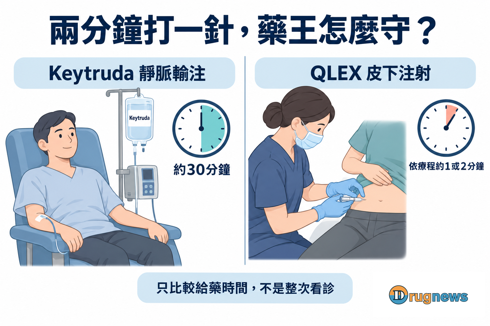
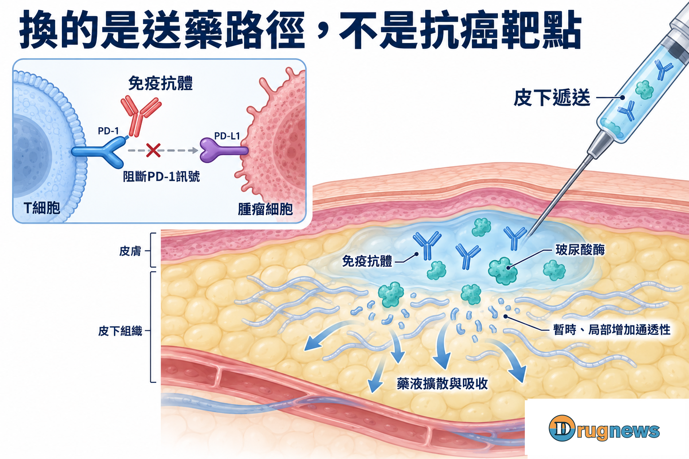
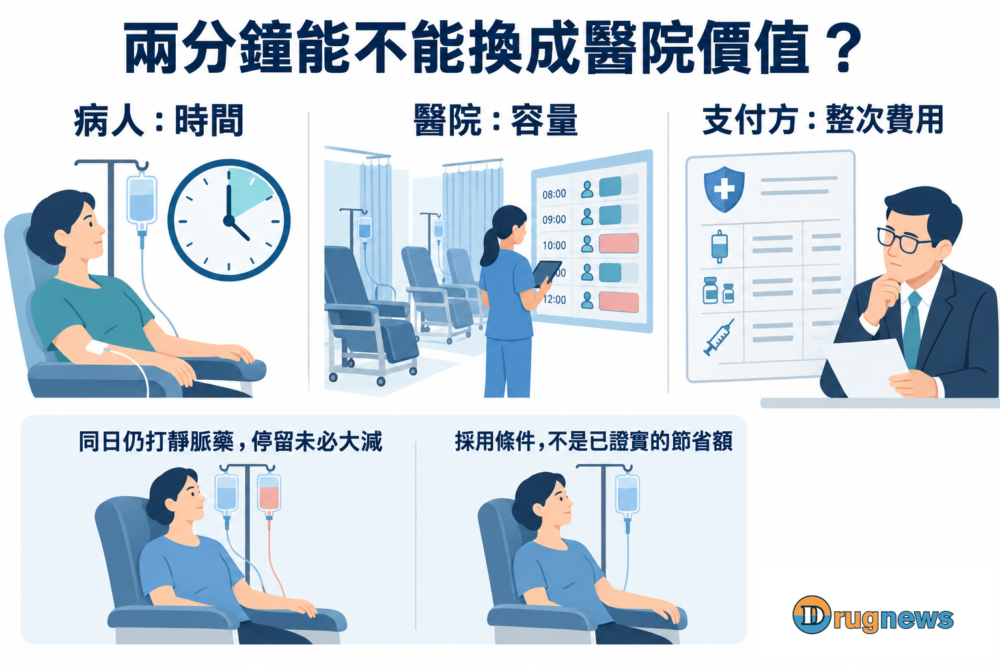
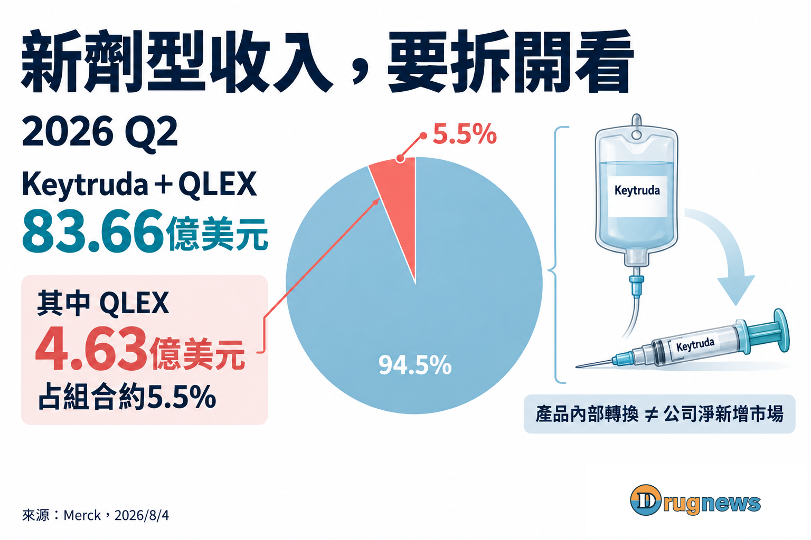

# 藥王保衛戰，默沙東撞上專利牆

一支藥撐起半家公司的營收，專利卻不會因此多給幾年。

默沙東選了韓國Alteogen，把Keytruda做成更方便的皮下劑型。下一支重磅新藥還得繼續開發，眼前這支藥王，先爭取下一段商業生命。

產品做出來了，FDA也核准了。擋在上市路上的，卻是另一家美國公司Halozyme。

10月7日，Halozyme宣布，荷蘭法院就MDASE專利EP622下達禁令，限制默沙東旗下MSD BV在荷蘭、法國、義大利等八個市場製造、銷售皮下版Keytruda。

靜脈版不受這道禁令影響。上述範圍來自Halozyme披露，法院判決全文尚未取得。

默沙東已經付錢買進合作夥伴的技術，為什麼還會被第三家公司攔下？這張禁令，又會讓原本談好的生意多付出什麼代價？

# 01｜半家公司的營收，不能只等下一支藥來接

2026年第二季，Keytruda與皮下版Qlex合計帶來83.66億美元營收，約占默沙東當季營收的一半。

這個數字背後，是一家大藥廠很難迴避的問題：最能帶來營收的產品，正在接近專利期限；接班的新藥，卻不能按公司的需要指定哪一天成功。

默沙東2025年報列明，Keytruda在美國的主要化合物專利將於2028年到期。同專利族另有兩件延至2029年，公司預期可能面臨訴訟；主要歐洲市場的期限則列在2031年。

美國與歐洲各有時鐘。2028不是全球同時失去所有保護的日期，也不能拿來推定歐洲同年就會出現替代品。

找新靶點、做新抗體，是為未來開疆闢土。只是臨床、核准、醫院採用，每一步都要時間。Keytruda面對的競爭，不會因為接班藥物還沒準備好，就自動延後。

皮下版於是成了守住既有生意的一種做法。

醫師已經熟悉pembrolizumab，默沙東要提供的，是讓部分合適療程更方便的給藥選擇。原抗體專利沒有重新計時，但醫院比較產品的方式，可能因此改變。

若兩邊都要靜脈輸注，價格容易成為焦點；若其中一邊能省下合適療程的給藥時間，採購便得把護理操作、治療空間與病人的時間算進去。

一支新劑型能否守住生意，最後要看這些便利在醫院裡值不值錢。寫在簡報上的優點，得先變成院方願意留下的服務。

*圖1｜依療程約1或2分鐘是QLEX的注射時間，不是完整看診時間；兩種產品的抗癌主成分皆為pembrolizumab。*

# 02｜一支酶，拿到了大藥生意的分潤門票

Alteogen切進這場生意，靠的是替藥液打開皮下的通道。

Keytruda的pembrolizumab會阻斷T細胞上的PD-1訊號，解除這條路徑造成的部分免疫抑制，讓抗腫瘤免疫反應有機會發揮。換成皮下版，抗癌主角仍是這支抗體。

然而，皮下並不是一個等著裝藥的空袋子。

細胞之間的網絡含有玻尿酸，會對藥液擴散形成阻力。靜脈輸注直接進血液，皮下注射則得先在組織裡散開，再被吸收。

Alteogen的玻尿酸酶berahyaluronidase alfa，能暫時、局部拆解玻尿酸，增加組織通透性，幫較大體積的藥液散開。它負責改善遞送，沒有改變抗體調動免疫反應的作用。

*圖2｜抗體阻斷PD-1路徑；玻尿酸酶暫時、局部增加皮下組織通透性，協助藥液擴散與吸收。機制示意，不按比例。*

能注射進去，還得證明換了路徑，身體仍能獲得合適的藥物暴露。

FDA核准依據中的377人隨機試驗，達到預設的藥物暴露量可比門檻；療效以描述性方式觀察，沒有顯示皮下版治癌更強。

開發換來的便利則很具體：由醫療人員操作，依療程約1或2分鐘完成注射，對照靜脈版約30分鐘的輸注。若同日仍需靜脈化療，省下的是其中一個環節，整次就醫不會縮成兩分鐘。

2024年2月，默沙東把原本非獨家的合作，改為皮下pembrolizumab的全球獨家授權，Alteogen並負責商業供酶。

這支酶的報酬，從此與重磅藥物的進展綁在一起。

默沙東2025年報列出，合作除了監管里程碑，還有合計最高10億美元的年度與累計銷售里程碑；全部銷售里程碑達成後，才開始支付淨銷售額低個位數百分比的權利金。

2025年美國與歐盟核准後，默沙東已實付4,000萬美元監管里程碑。

公司也判斷，未來銷售很可能觸發8.9億美元里程碑，因而認列相關負債。這筆8.9億美元當時尚未支付，仍待對應銷售條件達成。

Alteogen沒有自己持有pembrolizumab，卻能隨著它獲准、賣出、跨過門檻，取得相應報酬。技術公司不一定要再造一支藥王；解決藥王眼前的難題，也能形成可觀的生意。

對默沙東，幾個百分點又有多重要？

這裡自建一個只看費率敏感度的情境：皮下產品年淨銷售額若為100億美元，權利金每差1個百分點，一年就是1億美元。這是量級演算，並非Qlex銷售預測或本案已實現的節費。

但完整成本還有前段里程碑、供酶費與付款時序。低個位數權利金是在全部銷售里程碑之後才開始；精確費率及兩家可比的完整條款，不能由一個區間還原。

費率有多重要，可以估算；默沙東當年如何權衡價格、供應與技術，公開資料沒有給出完整答案。

# 03｜合約談好了，第三方的專利仍在門外

默沙東與Alteogen可以談妥怎麼用技術、怎麼供酶、怎麼分潤。Halozyme提出的權利主張，卻不會隨著兩家公司簽約而消失。

Halozyme透過ENHANZE經營皮下遞送授權，但它明確表示，這次涉案的MDASE專利與ENHANZE的專利不同，也不在ENHANZE授權計畫內。

因此，這場官司並非已證實的「沒付ENHANZE使用費，被追討欠款」。要爭的是，默沙東使用的配方是否落入第三方專利的保護範圍。

Alteogen能授予自家技術的使用權，FDA能核准產品按條件用於治療；這些進展，沒有一併替第三方專利爭議結案。

而且，各地法庭並未給出同一個答案。

默沙東2026年第二季SEC文件披露指出，Halozyme曾在英國同意撤銷EP622的英國部分。10月荷蘭的結果，則對默沙東不利。

不能拿一地的進展宣布全球勝負，卻也不能等到所有官司結束，才開始計算商業影響。

荷蘭禁令碰到的MSD BV，是歐洲上市許可持有人，也是包裝配送樞紐。在公告所述受限市場，新劑型的推出安排因而受阻。

藥已經準備好，供應與銷售的路卻被限制。這個問題，會從法務文件一路走到醫院採購桌前。

# 04｜上市空間可以再爭，錯過的時間怎麼追回？

靜脈版仍可供應，默沙東眼前的治療路徑沒有被這道禁令關掉。禁令的商業後果，也不能直接拿整個Keytruda營收來估。

但原有產品繼續賣，和新劑型及時站穩，是兩回事。

醫院換一個給藥流程，沒有藥廠換一張產品海報那麼快。

對不需要同日靜脈治療的合適病人，皮下注射可能帶來明顯便利；院方要把它做成日常服務，還得評估給付、採購、護理分工與排程，逐步累積使用經驗。

若供應在這段期間受限，這些工作便無法照原來的節奏展開。日後恢復上市，還得重新爭取進入醫院流程的機會；市場上的價格競爭，未必仍停在原地。

*圖3｜給藥更快是否轉為院端價值，取決於整次療程與工作流程；同日其他靜脈治療可能仍需停留。圖中情境不代表已實測的成本節省。*

Qlex在2026年第二季已有4.63億美元銷售，約占Keytruda產品組合營收5.5%。這是收入占比，不是已有5.5%的病人完成轉換。

*圖4｜2026年第二季組合銷售83.66億美元已包含QLEX的4.63億美元。產品內部轉換不是可以重複加總的公司新增市場。來源：Merck，2026年8月4日。*

一位原本使用靜脈版的病人改用Qlex，可以讓皮下版收入增加，公司卻沒有因此多出第二位病人。

所以，這場保衛戰不能只看新劑型成長多快。還要問：付出技術成本之後，它保留了多少本來可能流失的需求？

如果醫院只是換了產品名稱，流程沒有得到值得保留的改善，未來仍可能把價格放在最前面。只有當便利真正進入日常服務，皮下版才有條件爭取不同的選擇理由。

這也劃出了兩種策略的分工。改良遞送，是替既有生意增加競爭力；下一代新藥，則仍須創造新的治療價值。皮下版遇上官司，不會讓還在開發的新分子提早完成臨床。

默沙東得繼續爭取上市空間，也得面對採用時間正在流失的代價。

等產品能順利送進這些醫院時，院方會為這一針的便利，願意多付多少？

本文提供產業資訊與商業分析，不構成個別化醫療或投資建議。

# 來源

1. Halozyme，2026-10-07，荷蘭禁令公告（訴訟當事人披露）；MDASE與ENHANZE的區別亦出自此文。
https://ir.halozyme.com/news/news-details/2026/Halozyme-Wins-Injunction-Stopping-Manufacture-and-Sale-of-Mercks-Keytruda-SC-in-Multiple-European-Markets/default.aspx

2. Merck，2025 Form 10-K，主要專利表及註10（印刷第14頁）；Alteogen合作、實付款與未來里程碑見Note 3。
https://www.merck.com/wp-content/uploads/sites/124/2026/05/MRK-12.31.2025-10K-FINAL.pdf
https://www.sec.gov/Archives/edgar/data/310158/000031015826000063/R13.htm

3. Merck，2026-08-04，第二季財報與產品銷售表。
https://www.merck.com/news/merck-highlights-key-regulatory-and-clinical-milestones-across-broad-diverse-pipeline/

4. FDA，2025-09-19，Qlex核准及377人試驗依據。
https://www.fda.gov/drugs/resources-information-approved-drugs/fda-approves-pembrolizumab-and-berahyaluronidase-alfa-pmph-subcutaneous-injection

5. DailyMed，Qlex仿單第12.1節，PD-1及玻尿酸酶機制。
https://dailymed.nlm.nih.gov/dailymed/drugInfo.cfm?setid=097d166f-b73b-41d3-9b37-7653cd2a0c41

6. Merck，2025-09-19，Qlex核准公告、醫療人員給藥與注射時間。
https://www.merck.com/news/fda-approves-mercks-keytruda-qlex-pembrolizumab-and-berahyaluronidase-alfa-pmph-injection-for-subcutaneous-use-in-adults-across-most-solid-tumor-indications-for-keytruda-pem/

7. Alteogen，2024-02-22，MSD獨家授權修約與商業供酶公告。
https://alteogen.com/en/sub/ir/news.php?bid=13&idx=163&mode=view

8. Merck，2026年第二季SEC法律事項披露，早於荷蘭10月公告。
https://www.sec.gov/Archives/edgar/data/310158/000031015826000212/R15.htm
