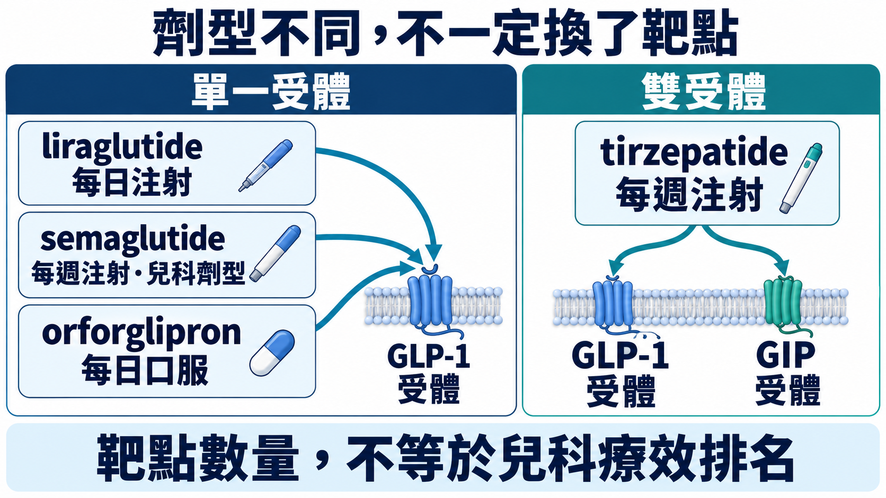
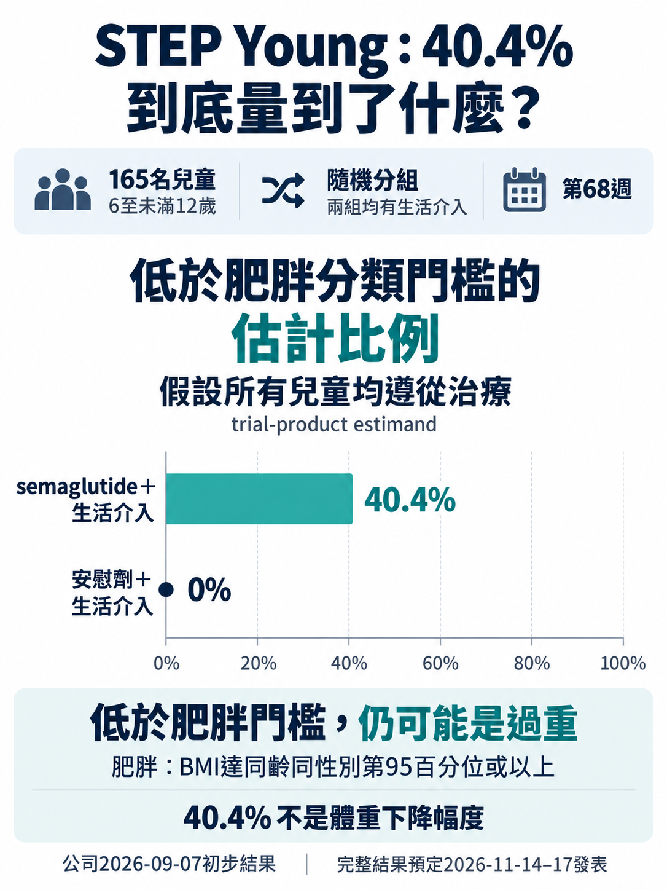
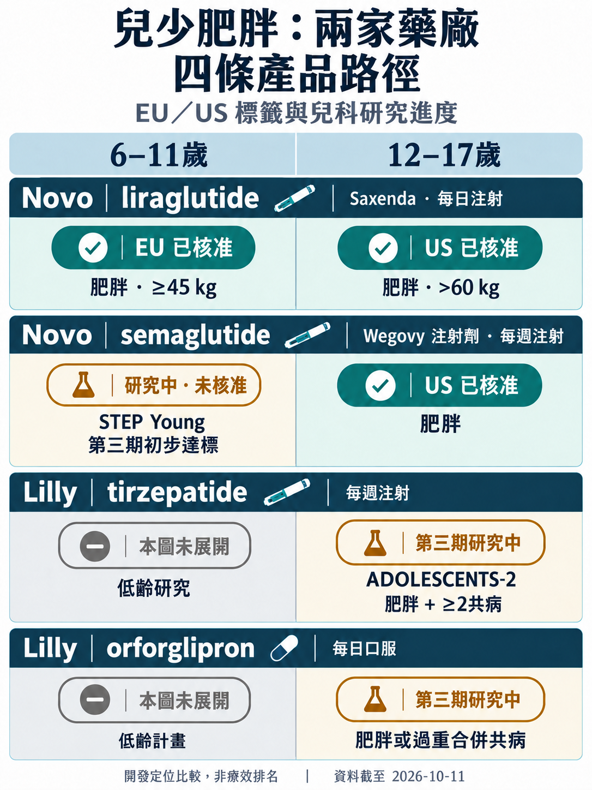
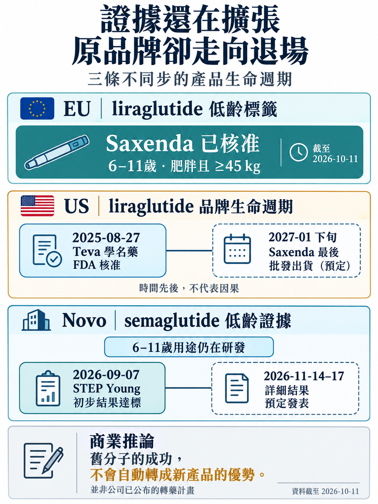

# 兒少肥胖用藥：Novo 的先發優勢，為何還要靠 Wegovy 接棒？

圖1｜劑型不同，不一定換了靶點
Liraglutide、semaglutide與orforglipron活化GLP-1受體，tirzepatide則同時活化GLP-1與GIP受體；這是給藥方式與受體作用的比較，雙受體不代表已證兒科療效較佳。Semaglutide的每週注射標示僅指本文兒科注射劑，該分子另有成人口服產品。圖為作用機制示意，不是受體結構或人體神經迴路。Tirzepatide與orforglipron的兒少肥胖用途仍在研究。〔3、6、7、12〕

# 01　同一個孩子，指引與藥品標籤可能給出不同答案

一款藥已在歐盟核准用於符合條件的六歲兒童，全球照護指引卻不建議九歲以下用藥。兒少肥胖的競爭，就從這個落差開始。〔2、15〕

WHO 在2026年10月7日發布兒少肥胖照護指引。依公告，0–9歲不建議藥物治療；10–19歲則要在受監督的多模式生活介入未達預期後，才考慮已核准藥物。另一方面，歐盟 Saxenda（liraglutide）標籤已涵蓋6至未滿12歲、體重至少45公斤且符合肥胖條件的兒童。WHO 提供照護建議，EMA 評估產品核准，兩者作用不同，前者沒有撤銷後者的標籤。〔2、15〕

這讓 Novo Nordisk 的領先多了一道考題：它已有低齡藥物證據與歐盟標籤，但每週注射、已有青少年標籤的 semaglutide，還要取得自己的低齡核准。對手 Eli Lilly 則正在研究另一種切入方式：從合併代謝問題的青少年，以及每日口服選項進場。兩家的差距，要沿著產品、年齡與治療情境來看。〔1、2、11、13〕

# 02　Saxenda 開了路，原品牌卻準備離開美國

Saxenda 是每天注射的 GLP-1 受體促效劑，歐盟已把適用年齡向下延伸。但在美國，它的兒科肥胖標籤仍是12歲以上、體重超過60公斤；FDA 又在2025年8月核准 Teva 首款以 Saxenda 為參照的學名藥。Novo 的美國官網如今預告，原品牌最後一批批發商出貨將在2027年1月下旬。公司給出的理由是使用人數下降、已有更多核准替代治療，並明確排除安全或品質原因；公告沒有將此事歸因於兒科策略。〔2、3、4、5〕

把這些事件放在一起，值得追的就不只是「兒童能不能用 GLP-1」，還包括「哪一個產品能承接新增的臨床價值」。Liraglutide 的低齡證據可以繼續存在，Saxenda 在美國的品牌經營卻走向結束。對 Novo 而言，若要延續兒少肥胖的原廠產品優勢，每週注射的 semaglutide 就成為關鍵觀察點。這是從產品組合推得的商業課題，並非公司已宣布讓兒童轉藥。〔1、2、4、5、6〕

Wegovy 注射劑在美國已有12歲以上肥胖適應症；Novo 9月公布的 STEP Young，則把 semaglutide 的第三期研究推到6至未滿12歲。165名兒童參與，68週 BMI 變化的主要終點達標。這比拿成人減重數字推測兒童效果前進了一步，但截至10月11日，這個低齡用途仍屬研發中。〔1、6〕

公告中的40.4%，指的是在假設依從治療的分析下，semaglutide 組有這個比例在68週時降到依年齡與性別判定的肥胖門檻以下，安慰劑組為0%；兩組都有生活介入。它不是體重減少40.4%。完整平均 BMI 變化與停藥情形仍要看後續數據，才能判斷這個亮眼的分類改善有多容易在實際照護中重現。〔1〕

圖2｜40.4%到底量到了什麼
STEP Young共有165名6至未滿12歲兒童參與；兩組均接受生活介入。第68週低於肥胖分類門檻的估計比例為40.4%與0%，採假設所有兒童遵從治療的分析，並非體重減少幅度。低於門檻仍可能屬過重；各組人數與此比例的分析分母未公布，不能用165直接換算反應人數。這是2026年9月7日公司初步結果中的分類指標，不是主要BMI變化終點的數值。〔1〕

如果完整資料與後續核准支持使用，Novo 有機會把既有青少年產品經驗延伸到更低年齡，減少重新建立產品認識的成本。這項時間優勢面臨兩面壓力：Teva 的學名藥在美國提供另一個競爭位置，Lilly 的新方案則可能改變選藥理由。前者能否形成價格或可及性優勢，取決於實際價格、供應與給付；目前尚無足夠資料判定這股壓力有多大。〔1、4、6、11、13〕

圖3｜兒少肥胖：兩家藥廠，四條產品路徑
本圖選取EU／US代表性標籤，不是完整核准清單；灰格表示未展開低齡研究，並非沒有計畫。STEP Young為6至未滿12歲第三期初步結果，低齡用途仍在研發。ADOLESCENTS-2要求肥胖且至少兩項指定共病：高血壓、血脂異常或糖尿病前期，並排除第二型糖尿病；另有SURMOUNT-ADOLESCENTS第三期研究。圖中ADOLESCENTS-2與orforglipron青少年試驗皆要求已進入青春期。Mounjaro美國10歲以上第二型糖尿病核准不等於兒科肥胖核准，未放入本矩陣。這是開發定位比較，不是療效或安全性排名。資料截至2026年10月11日。〔1、2、3、6、7、8、9、11、12、13〕

# 03　Lilly 的兩張牌：共病與口服

Lilly 並非沒有兒科資產：Mounjaro（tirzepatide）在美國已核准用於10歲以上第二型糖尿病。不過，糖尿病標籤不能代替肥胖標籤；Zepbound 的美國兒科安全性與有效性仍未確立。用成人競爭位置直接判定誰會贏得兒少肥胖，會漏掉這道適應症邊界。〔7、8〕

Tirzepatide 的 SURMOUNT-ADOLESCENTS 已完成收案；另一項第三期 SURMOUNT-ADOLESCENTS-2，則鎖定12–17歲、肥胖並至少合併兩項體重相關共病的族群，包括高血壓、血脂異常或糖尿病前期，並排除已罹患第二型糖尿病者。它要觀察的不只體重，還有心血管風險因子。這種設計若得到有臨床意義的結果，Lilly 就能圍繞「多個健康問題一起處理」建立選藥理由；它目前還不是已證實降低心血管事件的兒科療法。〔9、11〕

另一張牌是每日口服 GLP-1 藥物 orforglipron。它在美國以 Foundayo 用於成人；12–17歲的第三期研究另行進行，排除尚未進入青春期者。若兒科結果與核准成立，家庭可能在每週打針與每天服藥之間多一個選擇。給藥負擔會改變，但口服是否更能持續使用，需要實際資料；而且 Qsymia 早在2022年就取得美國12歲以上肥胖適應症，兒少口服治療並非從 Lilly 才開始。〔12、13、14〕

這兩條路，讓 Lilly 有機會避開只追趕年齡標籤的競爭：前一條要證明在多共病青少年中，BMI 以外能增加哪些治療價值；後一條要證明另一種給藥方式值得選擇。如果只有 BMI 改善，卻沒有足以影響臨床選擇的共病結果、耐受性或使用體驗，差異化就會縮小。Novo 因而可能有更多時間累積兒科產品經驗；反過來，真正有用的兒科差異也可能讓先進場者重新面對選藥競爭。〔11、13〕

圖4｜證據還在擴張，原品牌卻走向退場
歐盟liraglutide低齡標籤、美國學名藥核准與原品牌退場，以及semaglutide低齡新證據，是不同地區與階段的事件；連線只表時間先後。Novo所述美國Saxenda退場原因是使用人數下降與更多核准替代治療。2027年1月下旬為預定最後批發出貨，不代表全美藥局庫存當月歸零或全球liraglutide退出。新產品承接臨床價值是商業推論，並非已公布的兒童轉藥計畫。STEP Young詳細結果預定於2026年11月14–17日ObesityWeek發表。資料截至2026年10月11日。〔1、2、4、5、6〕

# 04　下一個催化劑，要看能否完成接棒

最近的檢驗點是2026年11月14–17日 ObesityWeek，Novo 預告將公布 STEP Young 詳細結果。最值得看的是平均 BMI 變化、把停藥納入後的效果、停藥原因，以及生長與青春期資料。若理想依從情境與納入停藥的分析差距很大，先發優勢可能停留在試驗新聞，難以轉成穩定的治療選擇。〔1〕

另一個時點是2027年1月下旬的美國 Saxenda 最後批發出貨。原品牌淡出之後，學名藥能否承接供應、新產品能否建立兒科位置，會分別影響市場留下哪些選擇。Lilly 的2026年第二季簡報則把 ADOLESCENTS-2 與 orforglipron 青少年試驗的主要完成時間，列在2027年10月與12月；這是開發時程，並非承諾在當月公布結果或上市。〔5、10〕

兒少肥胖這一局，Novo 已拿到比較具體的低齡證據位置，但維持原廠產品優勢仍要靠 semaglutide 把接棒做成。Lilly 的機會則在於，用共病或口服資料改變醫師與家庭選擇治療的理由。成人市場的強弱不會自動搬過來：在兒少，優勢要逐個年齡、逐個適應症、逐個產品重新建立。〔1、2、4、5、6、11、13〕

資料截至2026年10月11日。

本文僅供產業研究與知識分享，不構成投資、醫療、募資或個股建議。

# 參考資料
1｜Novo STEP Young 初步結果，2026-09-07
https://www.novonordisk.com/news-and-media/news-and-ir-materials/news-details.html?id=916600

2｜EMA Saxenda 歐盟產品資料
https://www.ema.europa.eu/en/medicines/human/EPAR/saxenda

3｜Saxenda 美國仿單，2026-02
https://www.novo-pi.com/saxenda.pdf

4｜FDA 2025 首次學名藥核准清單，第71筆
https://www.fda.gov/drugs/drug-and-biologic-approval-and-ind-activity-reports/2025-first-generic-drug-approvals

5｜Novo 美國 Saxenda 停售通知，查核2026-10-11
https://www.novomedlink.com/obesity/products/treatments/saxenda.html

6｜Wegovy 美國仿單，2026-06
https://www.novo-pi.com/wegovy.pdf

7｜Zepbound 美國仿單
https://pi.lilly.com/us/zepbound-uspi.pdf

8｜Mounjaro 美國仿單，2026-08
https://pi.lilly.com/us/mounjaro-uspi.pdf

9｜Lilly SURMOUNT-ADOLESCENTS，NCT06075667
https://trials.lilly.com/en-US/trial/427361

10｜Lilly 2026 Q2 簡報，第40及48頁
https://investor.lilly.com/static-files/ab69001c-650b-44f6-b629-309ee33f2335

11｜Lilly SURMOUNT-ADOLESCENTS-2，NCT06439277
https://trials.lilly.com/en-US/trial/494896

12｜FDA Foundayo 美國仿單，2026
https://www.accessdata.fda.gov/drugsatfda_docs/label/2026/220934s003lbl.pdf

13｜Lilly orforglipron 青少年試驗，NCT06672939
https://trials.lilly.com/en-US/trial/551535

14｜FDA Qsymia 青少年核准，2022
https://www.fda.gov/drugs/news-events-human-drugs/fda-approves-treatment-chronic-weight-management-pediatric-patients-aged-12-years-and-older

15｜WHO 兒少肥胖指引公告，2026-10-07
https://www.who.int/tokelau/news/detail-global/07-10-2026-who-issues-first-global-guidelines-on-child-and-adolescent-obesity
